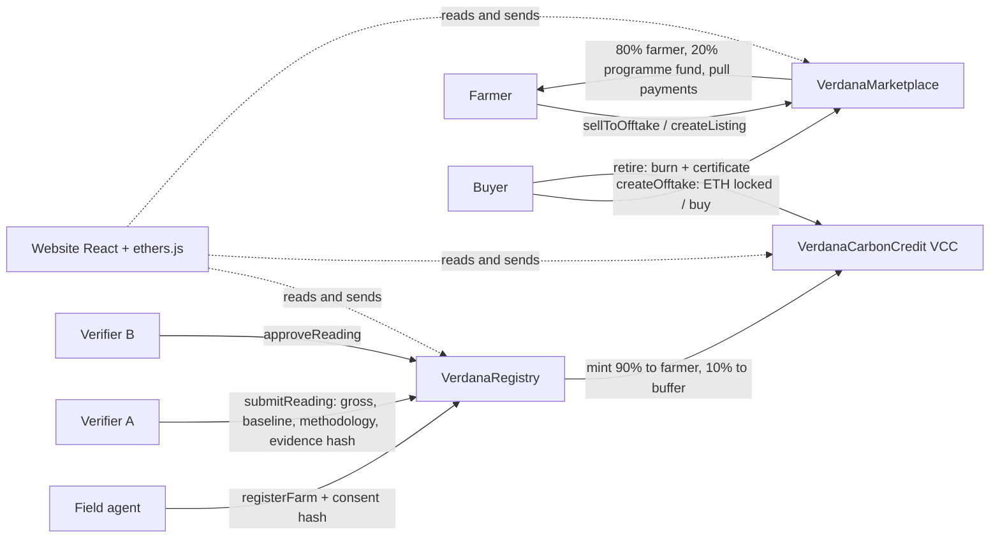

# Verdana Protocol (Ethereum edition)

**Making protecting trees economically meaningful to the people living alongside them.**

Verdana is a climate-finance access and coordination solution for smallholder farmers. It brings dispersed farms into one programme, records independently verified carbon removals, lets buyers commit funding up front, and shares every sale transparently with the farmer. Blockchain is the trust and accountability layer, not the source of carbon value.

> Final summative project for *Cryptocurrency and Digital Assets*. Author: **Hauwa Muhammad Bello**.
> Testnet demo with illustrative data. VCC are test tokens with no monetary value.

| | |
|---|---|
| Live website | https://noorul-ayn.github.io/verdana-protocol-ethereum/ |
| Network | Ethereum Sepolia testnet (chain ID 11155111) |
| Contracts | `VerdanaRegistry`, `VerdanaCarbonCredit` (ERC-20 "VCC"), `VerdanaMarketplace` (addresses below) |
| Tests | 45 passing, 100% statement and function coverage ([TEST_CASES.md](TEST_CASES.md)) |
| Deployment guide | [DEPLOYMENT_GUIDE.md](DEPLOYMENT_GUIDE.md) |

---

## Sepolia deployment (24 November 2026)

| Contract | Address |
|---|---|
| VerdanaRegistry | [`0x322FEDB45a70b3b298C8352336e54512FC3CEA50`](https://sepolia.etherscan.io/address/0x322FEDB45a70b3b298C8352336e54512FC3CEA50) |
| VerdanaCarbonCredit (VCC) | [`0xecA1067952822b1291770B41eDcBb91D01277a94`](https://sepolia.etherscan.io/address/0xecA1067952822b1291770B41eDcBb91D01277a94) |
| VerdanaMarketplace | [`0x47ea54BB4447Eb8e1eF7FdD4DE64040a2418b2AF`](https://sepolia.etherscan.io/address/0x47ea54BB4447Eb8e1eF7FdD4DE64040a2418b2AF) |

All three contracts are **verified on Etherscan**, so the source code can be read on each address's Contract tab.

Deployer, admin, field agent and verifier A: [`0xf142fc07c9304DcECB019afDC9249683402E430E`](https://sepolia.etherscan.io/address/0xf142fc07c9304DcECB019afDC9249683402E430E). Verifier B: [`0xFC9394d8f2c712F8441Eb4Bb9f661Bf401BaA0cB`](https://sepolia.etherscan.io/address/0xFC9394d8f2c712F8441Eb4Bb9f661Bf401BaA0cB).

The full programme was then run on Sepolia with `scripts/interact.js`. It registered 2 farms and submitted 2 MRV reports, which verifier B approved, verifying 14,400 kg CO₂e. 8.4 VCC are in circulation, 1.44 VCC sit in the buffer pool and 6 VCC were retired (certificate #1). Buyers paid 0.00008 ETH: 80% to farmers and 20% to the programme fund. The live contracts refused all five forbidden actions the script tried. Key transactions:

- Verifier B approves farm 1's report: [`0x0f2fad10…d0d4cc14d6`](https://sepolia.etherscan.io/tx/0x0f2fad1061a050280245648f01cd05b9c7c392d67b268ea57913d2d0d4cc14d6)
- Buyer commits funding for 10 tonnes: [`0x3531c190…ccc5242720`](https://sepolia.etherscan.io/tx/0x3531c190b876c1349b1710a7a43104f24a37c63b11fceda88f0157ccc5242720)
- Amina sells 6 VCC into it and is paid at once: [`0x355a660d…26b402d76`](https://sepolia.etherscan.io/tx/0x355a660df83d9cf76ba320e83046c7acfe56a5e5bbb391d3608212326b402d76)
- Buyer retires 6 VCC (certificate #1): [`0xd4ff2873…0fe78da5d`](https://sepolia.etherscan.io/tx/0xd4ff28731334545c9a282d0ccf727ae1d313c0f7f75f04ca866d3930fe78da5d)

Anyone can check the current state without a key: `npm run status:sepolia`.

---

## 1. The problem

For a smallholder farmer, cutting a tree and selling the timber pays today. Keeping it standing protects the climate, but that value rarely turns into income for the person protecting it.

Carbon markets could pay for conservation, but individual smallholders struggle to take part:

- Measurement, monitoring and verification (MRV) are complex and expensive.
- Landholdings are small and scattered, so each one is too small to be a carbon project on its own.
- Farmers rarely have the technical capacity, or a route to credible buyers.

So the people who could contribute most to nature-based climate solutions are often cut off from the finance designed to support them.

| Stakeholder | Their problem |
|---|---|
| Smallholder farmers | Limited financial incentive, and limited access to carbon finance |
| Carbon project developers | Hard to find, aggregate and monitor many dispersed participants |
| Carbon credit buyers | Need credible evidence, traceability and confidence that a tonne is real and counted once |

**Mission alignment.** My mission is to make the digital systems that pay Africans for climate action trustworthy, so that farmers and communities are paid for the results they earn. This project rebuilds my hackathon project (Verdana Protocol, Cardano, 2025 African Blockchain Championship) on Ethereum. It also fixes the flaw I found in that version: *any wallet could submit a carbon reading*.

## 2. The solution

1. **Enrol.** A field agent registers the farm with a hash of its grid cell (never exact GPS) and of the farmer's signed land-rights and consent record. Farmers pay nothing to join.
2. **Monitor.** Remote sensing tracks canopy and land-use change, and field plots measure the trees. Satellites alone do not measure CO₂: an approved methodology turns the data into an estimate.
3. **Verify.** Only removals **above the baseline** count, and the methodology's **leakage** deduction is applied. A **second, independent verifier** must approve before any credit exists. **10%** of every issuance goes to a **permanence buffer** that covers trees lost later.
4. **Fund.** Buyers either **commit funding up front** (an offtake), with ETH locked on-chain for future tonnes at a fixed price, or buy on the **open market**. Farmers are only ever paid from money already in the contract, never from a promise.
5. **Share.** Every sale is split by a public rule fixed in the contract: **80% to the farmer, 20% to the programme fund**, which pays for monitoring, verification and aggregation (Verdana's revenue model). The farmer's share can never be set below 70%. Withdrawal is the point where an off-chain service would pay out through mobile money.
6. **Retire.** A company that uses credits retires them: they are burned and a public certificate is recorded, so a tonne can never be claimed twice.

### What Verdana does not claim

Verdana is not the first blockchain carbon platform, and it does not measure carbon from satellites on its own. Its contribution is the combination of **accessibility**, **aggregation**, **monitoring support**, **transparency** and **financial inclusion**, with the rules that protect farmers and buyers enforced in code.

## 3. Architecture



| Contract | Role | Key security measures |
|---|---|---|
| `VerdanaRegistry` | Farms, methodologies, MRV reports, two-verifier approval, issuance, reversals | `AccessControl` roles; two-verifier rule; no self-verification; additionality, leakage and plausibility checks; one report per farm per quarter; one registration per plot; `Pausable`; checks-effects-interactions |
| `VerdanaCarbonCredit` | ERC-20 credit (1 VCC = 1 t CO₂e), retirement certificates, buffer cancellation | Only the registry can mint or cancel; retirement burns tokens and records a certificate |
| `VerdanaMarketplace` | Committed funding (offtakes), open market, 80/20 split, payouts | No owner or admin; `ReentrancyGuard`; `SafeERC20`; pull payments; exact-payment checks; funds locked until expiry; minimum 70% farmer share |

The contracts are written in Solidity 0.8.28 on OpenZeppelin Contracts 5.6, and every function has NatSpec comments.

## 4. Quick start (local)

Requires Node.js 20 or later.

```bash
npm install
npm run frontend:install
npx hardhat test                 # 45 passing
```

Run the full programme on a local blockchain:

```bash
npx hardhat node                 # terminal 1: local blockchain
npm run deploy:local             # terminal 2: deploy and wire the contracts
npm run demo:local               # terminal 2: register, report, verify, fund, sell, pay, retire
npm run dev                      # terminal 2: website at http://localhost:5173
```

For the Sepolia testnet, Etherscan verification and GitHub Pages, follow [DEPLOYMENT_GUIDE.md](DEPLOYMENT_GUIDE.md).

## 5. The website

| Page | Who uses it | What it does |
|---|---|---|
| Overview | Everyone | Problem, how it works, live programme totals read from the chain |
| Farms & Reports | Everyone (no wallet needed) | Every farm and MRV report; **check a document** against its on-chain SHA-256 |
| Verifier Console | Field agents, verifiers | Register farms, submit reports with a live net/buffer preview, approve or reject, record reversals |
| My Farm | Farmers | Credits, earnings, sell into committed funding, list on the open market, withdraw |
| Funding & Market | Buyers | Commit funding, buy listed credits, retire credits, certificates |
| Admin | Programme operator | Grant or revoke roles, approve methodologies, pause |

Every rule is enforced by the contracts. When a rule is broken, the website shows the contract's refusal in plain language, e.g. *"The smart contract refused this: A second, different verifier must approve."*

## 6. Project structure

```
contracts/
  VerdanaRegistry.sol        farms, methodologies, MRV reports, approvals, reversals
  VerdanaCarbonCredit.sol    ERC-20 VCC token, retirements, buffer cancellation
  VerdanaMarketplace.sol     committed funding, open market, benefit sharing, payouts
  test/ReentrancyAttacker.sol   attack contract used only by the tests
scripts/
  deploy.js                  deploy, grant roles, approve methodology, export ABIs
  interact.js                end-to-end programme run (local or Sepolia), with security checks
  status.js                  read-only summary of a deployment (no key needed)
  show-personas.js           demo account addresses/keys for MetaMask (Sepolia)
test/
  Verdana.test.js            TC-01 to TC-40, smart contracts
  VerdanaDapp.test.js        TC-41 to TC-45, website code against the contracts
samples/
  land-records/              demo land-rights and consent records
  mrv-reports/               demo MRV reports (remote sensing + field plots + calculation)
frontend/                    React + Vite + ethers.js dApp
```

## 7. Limitations and next steps

- **Demo methodology and data.** A real programme would use a recognised, peer-reviewed methodology and accredited third-party verifiers.
- **Verifiers are trusted roles.** Two independent approvals reduce, but do not remove, the risk of collusion. Next steps are verifier staking and slashing, rotating random assignment, and signed data feeds from satellite providers.
- **Payments in ETH.** A production version would use a stablecoin, plus an off-chain mobile-money payout partner at the withdrawal step.
- **Admin key.** The admin and programme fund should be a multisig wallet, with a timelock on settings changes.
- **Privacy.** Only hashes go on-chain; the documents themselves need secure off-chain storage with farmer consent.

## 8. Versions

Solidity 0.8.28 (EVM Cancun) · OpenZeppelin Contracts 5.6.1 · Hardhat 2.29 + hardhat-toolbox 6.1 · ethers.js 6.17 · React 19 · Vite 8 · Node.js 20+.

## License

MIT
